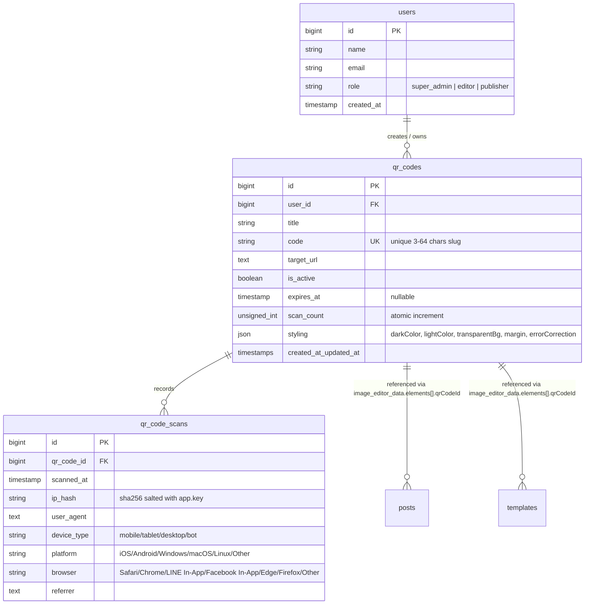
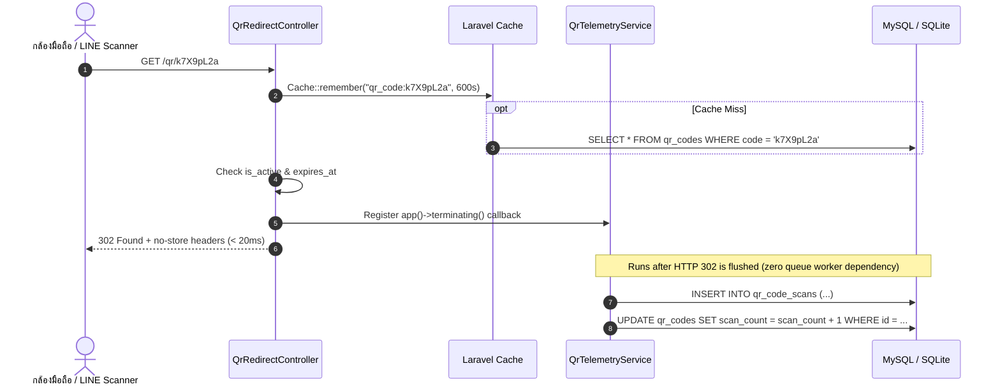

# System, Data & Security Modeling: Dynamic QR Code Architecture

---

## 1. Tech Stack Selection & Rationale

| Layer | Selected Technology | Rationale & 12-Factor Justification |
| :--- | :--- | :--- |
| **Backend Framework** | Laravel 13.x (PHP 8.3) | สอดคล้องกับแกนหลักของ Poster, มี Eloquent ORM, Request Validation, Terminating Callbacks, และ Unit/Feature Testing ครบถ้วน |
| **Frontend Framework** | React 18 + Inertia.js v2 | สถาปัตยกรรม SPA ไร้รอยต่อโดยไม่ต้องเขียน REST Client แยก, แชร์ Session, CSRF และ Ziggy Named Routes จาก Laravel โดยตรง |
| **Styling & Icons** | Tailwind CSS + `lucide-react` | ยึดตาม Design Tokens เดิมของระบบ (สี `#000080` แบรนด์หลัก) และไอคอนคมชัดขนาดเบา |
| **Canvas Graphic Engine** | `konva` 10.7 + `react-konva` 18.2 | เอนจิน Canvas 2D ที่มีอยู่ในระบบแล้ว รองรับการลาก (Drag), ปรับขนาด (Transform ล็อกมุม 1:1), หมุน (Rotate), และ Flatten เป็นไฟล์ภาพคุณภาพสูง |
| **Client QR Engine** | `qrcode` (npm v1.5.4) | สร้าง Data URL รูปแบบ PNG/Base64 ใน Memory บนเบราว์เซอร์ได้ทันที ไม่ต้องผ่านเครือข่าย ป้องกันปัญหา Cross-Origin Tainted Canvas 100% และไม่เก็บ Base64 ก้อนใหญ่ลง DB |
| **Server QR Engine** | `endroid/qr-code` (v6.0.9) | ครอบ `bacon/bacon-qr-code` v3 ไว้ภายใน รองรับทั้ง `SvgWriter` และ `PngWriter` (ผ่าน `ext-gd` แท้ที่มีในเครื่องโดยไม่ต้องพึ่ง `ext-imagick`) พร้อมปรับสีและพื้นหลังโปร่งใสได้ |
| **Database & Telemetry** | MySQL / SQLite + `app()->terminating()` | ใช้ MySQL ใน Production และ SQLite `:memory:` ใน PHPUnit โดยบันทึกสถิติหลังส่ง HTTP 302 Response (`terminating` callback) ไม่บล็อกผู้ใช้และไม่ต้องพึ่ง Queue Daemon |

---

## 2. Data Model & Schema

### 2.1 Entity Relationship Diagram (ERD)


### 2.2 Database DDL Specifications

```sql
-- Table: qr_codes
CREATE TABLE `qr_codes` (
    `id` BIGINT UNSIGNED NOT NULL AUTO_INCREMENT PRIMARY KEY,
    `user_id` BIGINT UNSIGNED NOT NULL,
    `title` VARCHAR(191) NOT NULL,
    `code` VARCHAR(64) NOT NULL,
    `target_url` TEXT NOT NULL,
    `is_active` TINYINT(1) NOT NULL DEFAULT 1,
    `expires_at` TIMESTAMP NULL DEFAULT NULL,
    `scan_count` INT UNSIGNED NOT NULL DEFAULT 0,
    `styling` JSON NULL,
    `created_at` TIMESTAMP NULL DEFAULT NULL,
    `updated_at` TIMESTAMP NULL DEFAULT NULL,
    UNIQUE KEY `qr_codes_code_unique` (`code`),
    KEY `qr_codes_user_id_foreign` (`user_id`),
    KEY `qr_codes_is_active_index` (`is_active`),
    KEY `qr_codes_created_at_index` (`created_at`),
    CONSTRAINT `qr_codes_user_id_foreign` FOREIGN KEY (`user_id`) REFERENCES `users` (`id`) ON DELETE CASCADE
) ENGINE=InnoDB DEFAULT CHARSET=utf8mb4 COLLATE=utf8mb4_unicode_ci;

-- Table: qr_code_scans
CREATE TABLE `qr_code_scans` (
    `id` BIGINT UNSIGNED NOT NULL AUTO_INCREMENT PRIMARY KEY,
    `qr_code_id` BIGINT UNSIGNED NOT NULL,
    `scanned_at` TIMESTAMP NOT NULL DEFAULT CURRENT_TIMESTAMP,
    `ip_hash` VARCHAR(64) NOT NULL,
    `user_agent` TEXT NULL,
    `device_type` VARCHAR(32) NOT NULL DEFAULT 'other',
    `platform` VARCHAR(64) NOT NULL DEFAULT 'Other',
    `browser` VARCHAR(64) NOT NULL DEFAULT 'Other',
    `referrer` TEXT NULL,
    KEY `qr_code_scans_qr_id_scanned_at_idx` (`qr_code_id`, `scanned_at`),
    KEY `qr_code_scans_device_type_index` (`device_type`),
    CONSTRAINT `qr_code_scans_qr_code_id_foreign` FOREIGN KEY (`qr_code_id`) REFERENCES `qr_codes` (`id`) ON DELETE CASCADE
) ENGINE=InnoDB DEFAULT CHARSET=utf8mb4 COLLATE=utf8mb4_unicode_ci;
```

### 2.3 Lightweight Canvas Element Schema (`image_editor_data.elements`)
เพื่อป้องกันปัญหา JSON Bloat บน Autosave และการส่งข้อมูลผ่าน Inertia ระบบจะ **ไม่เก็บ Base64 PNG (`src`)** ของ QR Code ลงในฐานข้อมูล แต่จะเก็บเฉพาะโครงสร้าง Metadata น้ำหนักเบา:
```json
{
  "id": "uuid-v4",
  "type": "qr",
  "qrCodeId": 12,
  "code": "job-2026",
  "title": "ใบสมัครงาน 2569",
  "scanUrl": "https://domain.ac.th/poster/qr/job-2026",
  "targetUrl": "https://drive.google.com/...",
  "styling": {
    "darkColor": "#000000",
    "lightColor": "#ffffff",
    "transparentBg": false,
    "margin": 2,
    "errorCorrection": "H"
  },
  "x": 420,
  "y": 420,
  "width": 240,
  "height": 240,
  "rotation": 0,
  "opacity": 1
}
```

---

## 3. API & Contract Specifications

### 3.1 Public Redirection & Media Endpoints

#### `GET /qr/{code}` (`qr.redirect`)
- **Access:** Public, Rate Limited (`throttle:120,1`).
- **Subdirectory Safe:** รองรับทั้ง `/qr/{code}` และ `/poster/qr/{code}` ผ่าน Ziggy / Named Route.
- **Responses:**
  - `302 Found` with `Location: {target_url}`, `Cache-Control: no-store, no-cache, must-revalidate, max-age=0`, `Pragma: no-cache`
  - `410 Gone` / `200 OK` (renders polite Thai Inactive Blade page `resources/views/qr/inactive.blade.php` if `is_active === false` or `expires_at < now()`)
  - `404 Not Found` (if `code` does not exist)

#### `GET /qr/{code}/image` (`qr.image`)
- **Access:** Public, Rate Limited (`throttle:60,1`).
- **Query Params:**
  - `format`: `svg` (default) | `png`
  - `size`: integer (default `400`, min `100`, max `2000`)
  - `download`: `0` | `1` (triggers `Content-Disposition: attachment`)
- **Responses:** `200 OK` with `Content-Type: image/svg+xml` or `image/png`.

### 3.2 Management Endpoints (`auth, verified`)

- `GET /qr-codes` (`qr-codes.index`): Inertia page `'QrCodes/Index'` หรือ JSON สำหรับ `QrSelectorPopover` ใน `ImageEditorModal`
- `POST /qr-codes` (`qr-codes.store`): สร้าง Dynamic QR Code ใหม่ (รองรับทั้ง Inertia Redirect และ JSON 201 สำหรับ Quick Create ใน `ImageEditorModal`)
- `PUT /qr-codes/{qrCode}` (`qr-codes.update`): แก้ไขชื่อ, `target_url`, `code`, `is_active`, `expires_at`, `styling` (พร้อมล้าง Cache `qr_code:{code}` ทันที)
- `DELETE /qr-codes/{qrCode}` (`qr-codes.destroy`): ตรวจสอบก่อนว่าไม่ได้ถูกใช้งานอยู่ใน `Post` หรือ `Template` (`image_editor_data`) หากถูกใช้งานอยู่จะปฏิเสธการลบพร้อมแนะนำให้ปิดสถานะ `is_active` แทน (ตามมาตรฐานเดียวกับ `MediaController::destroy`)
- `GET /qr-codes/{qrCode}/analytics` (`qr-codes.analytics`): คืนค่าสถิติรายวัน (คำนวณแบบ Cross-DB รองรับทั้ง MySQL และ SQLite), อุปกรณ์, OS, และเบราว์เซอร์

---

## 4. Data & State Flow

### 4.1 Low-Latency Redirection & Post-Response Telemetry


---

## 5. Security, Auth & RBAC

1. **Ownership & Team Collaboration (`QrCodePolicy`):**
   - สมาชิกทุกคนที่ล็อกอิน (`auth, verified`) สามารถดูรายการและนำ QR Code ไปแทรกลงในโปสเตอร์ร่วมกันได้ (`viewAny`, `view`).
   - เฉพาะผู้สร้าง (`$qrCode->user_id === $user->id`) หรือผู้ดูแลสูงสุด (`$user->role === 'super_admin'`) เท่านั้นที่สามารถแก้ไข (`update`) หรือลบ (`delete`) QR Code นั้นได้.
2. **Open Redirect & SSRF Defense (`App\Rules\SafeRedirectUrl`):**
   - บังคับเฉพาะ Scheme `http` และ `https`.
   - บล็อก Hostname ภายใน (`localhost`, `*.local`, `*.internal`) และตรวจทั้ง IPv4 / IPv6 ด้วย `FILTER_FLAG_NO_PRIV_RANGE | FILTER_FLAG_NO_RES_RANGE` (โดยใน Production ตรวจ DNS records เพิ่มเติมอย่างปลอดภัย และไม่กระทบการรัน PHPUnit แบบออฟไลน์).
3. **PDPA / Privacy Hashing:**
   - ห้ามเก็บ Plaintext IP เด็ดขาด ใช้ `hash_hmac('sha256', (string) $request->ip(), (string) config('app.key'))`.
4. **12-Factor Public Base URL Config (`.env.example`):**
   - เพิ่ม `QR_PUBLIC_BASE_URL=` (optional, fallback ไปยัง Request Root / `APP_URL`) พร้อมระบบเตือนบน UI เมื่อตรวจพบว่า URL สแกนเป็น `localhost` หรือ `127.0.0.1`.

---

## 6. Project Directory Scaffolding

```text
app/
├── Http/
│   ├── Controllers/
│   │   ├── QrCodeController.php             # CRUD, Analytics, Safe Deletion, Image Serving
│   │   └── QrRedirectController.php         # Public 302 redirect & inactive status handler
│   └── Requests/
│       ├── StoreQrCodeRequest.php           # Validation using SafeRedirectUrl
│       └── UpdateQrCodeRequest.php          # Validation & authorization
├── Models/
│   ├── QrCode.php                           # Eloquent model + automatic Cache invalidation
│   └── QrCodeScan.php                       # Scan history & metrics model
├── Policies/
│   └── QrCodePolicy.php                     # Owner & super_admin authorization
├── Rules/
│   └── SafeRedirectUrl.php                  # Custom SSRF & Open-Redirect validation rule
└── Services/
    ├── QrCodeGeneratorService.php           # SVG & PNG generation via endroid/qr-code
    └── QrTelemetryService.php               # UA classification, IP HMAC, & terminating write

resources/
├── views/
│   └── qr/
│       └── inactive.blade.php               # Branded Thai inactive/expired landing page
└── js/
    ├── Components/
    │   ├── ImageEditorModal.jsx             # Modified: QR toolbar, 1:1 corner lock, sidebar
    │   └── QrCode/
    │       ├── QrSelectorPopover.jsx        # 2-tab Library picker & Quick Create inside Editor
    │       ├── QrCodeFormModal.jsx          # Create/Edit modal with live preview & localhost warning
    │       ├── QrCodeAnalyticsModal.jsx     # Visual charts & scan logs modal
    │       └── QrCodeDownloadModal.jsx      # Multi-resolution PNG & SVG download
    ├── Pages/
    │   └── QrCodes/
    │       └── Index.jsx                    # QR Codes management dashboard (5 UI states)
    └── Utils/
        └── qrcode.js                        # Client-side high-res PNG DataURL helper
```
