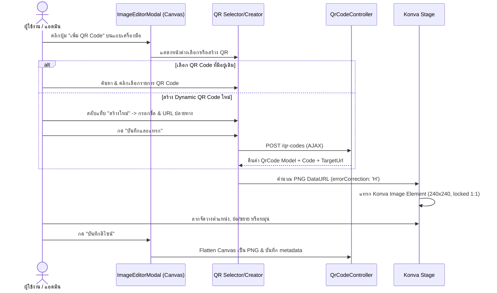
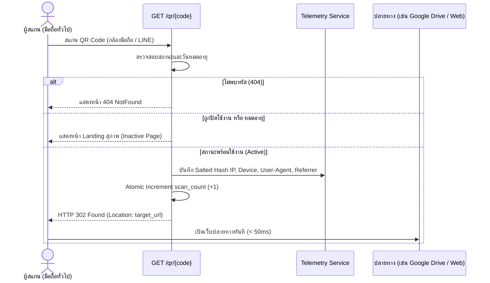

# UX Architecture & Design System: Dynamic QR Code & Image Editor Integration

---

## 1. Screen Inventory & Routing

| Screen ID | Screen Name | Route / Path | Access Guard | Primary Action / Purpose |
| :--- | :--- | :--- | :--- | :--- |
| **SCR-01** | Dynamic QR Code Index | `/qr-codes` (`qr-codes.index`) | `auth, verified` | แสดงสารบัญ QR Code ทั้งหมด, ค้นหา, สรุปสถิติสแกน, คัดลอกลิงก์, ดาวน์โหลด |
| **SCR-02** | Create/Edit QR Modal | *Modal on `/qr-codes`* | `auth, verified` | สร้าง QR Code ใหม่ หรือแก้ไข `target_url`, ชื่อ, และสถานะเปิด/ปิด |
| **SCR-03** | QR Analytics Modal | *Modal on `/qr-codes`* | `auth, verified` | ดูกราฟแนวโน้มการสแกนรายวัน, สัดส่วนอุปกรณ์ (Mobile/Desktop), และประวัติสแกนล่าสุด |
| **SCR-04** | Image Editor Modal (QR) | *Modal on `/posts/*` & `/templates/*`* | `auth, verified` | เพิ่ม/ลาก/ย่อขยาย/หมุน QR Code บน Canvas โปสเตอร์ |
| **SCR-05** | Public Inactive/Expired Landing | `/qr/{code}` *(when inactive)* | Public (No Auth) | หน้าแจ้งเตือนผู้สแกนเมื่อ QR ถูกระงับหรือหมดอายุอย่างสุภาพ |

---

## 2. User Flows & Interaction Sequences

### Flow 1: สร้างและแทรก QR Code ลงในโปสเตอร์จาก Image Editor Modal

### Flow 2: ผู้สแกนเข้าถึง URL และการเปลี่ยนเส้นทาง (Redirection Loop)

---

## 3. Scott Hurff's 5 UI States Matrix

### 3.1 Screen: Dynamic QR Code Index (`/qr-codes`)
- **Ideal State:**
  - สรุปตัวชี้วัดด้านบน: การ์ด 3 ใบ (จำนวน QR ทั้งหมด, ยอดสแกนสะสมรวม, ยอดสแกน 7 วันล่าสุด)
  - แถบเครื่องมือ: ช่องค้นหา (Search input), ตัวกรองสถานะ (ทั้งหมด / เปิดใช้งาน / ปิดใช้งาน), ปุ่ม "+ สร้าง Dynamic QR Code ใหม่"
  - ตารางหรือการ์ดกริด: แสดงพรีวิวภาพ QR Code ชัดเจน, ชื่อกำกับ, รหัสย่อ (พร้อมปุ่มคลิกคัดลอก `domain/qr/{code}` พร้อม Toast feedback "คัดลอกลิงก์แล้ว"), ลิงก์ปลายทาง (คลิกเปิดแท็บใหม่ได้), สถานะ Badge เขียว/เทา, ตัวเลขยอดสแกนพร้อมไอคอนสถิติ, ปุ่มเมนู Action (แก้ไข, ดูกราฟสถิติ, ดาวน์โหลด PNG/SVG, ลบ)
- **Empty State:**
  - แสดงภาพไอคอน QR Code นุ่มนวลตรงกลางจอ พร้อมหัวข้อ: *"ยังไม่มี Dynamic QR Code ในระบบ"*
  - ข้อความอธิบาย: *"สร้าง Dynamic QR Code เพื่อนำไปใส่ในโปสเตอร์ประชาสัมพันธ์ และเปลี่ยนลิงก์ปลายทางได้ตลอดเวลาโดยไม่ต้องทำรูปใหม่"*
  - ปุ่ม Call to Action (CTA) สีน้ำเงินเข้มเด่นชัด: `[ + สร้าง Dynamic QR Code แรกของคุณ ]`
- **Loading State:**
  - แสดง Skeleton Cards หรือ Skeleton Table Rows 5 แถว พร้อมเอฟเฟกต์ `animate-pulse` สีเทาอ่อน (ไม่มีสปินเนอร์หมุนลอยเคว้ง)
- **Partial State:**
  - มีเพียง 1-2 รายการ: ตารางแสดงผลกะทัดรัด พร้อมการ์ดแนะนำทริคการนำไปใช้งาน (Pro-tip: แทรกลงใน Image Editor ได้ทันที)
  - ค้นหาแล้วไม่เจอผลลัพธ์: แสดงข้อความ *"ไม่พบ QR Code ที่ตรงกับคำค้นหา '{query}'"* พร้อมปุ่ม *"ล้างการค้นหา"*
- **Error State:**
  - เมื่อเครือข่ายขัดข้อง: แสดง Alert สีแดงขอบมนด้านบน พร้อมข้อความแจ้งข้อผิดพลาด และปุ่ม `[ ลองใหม่อีกครั้ง ]`

### 3.2 Component: QR Code Integration in Image Editor (`ImageEditorModal.jsx`)
- **Ideal State:**
  - ปุ่ม "เพิ่ม QR Code" พร้อมไอคอน `QrCode` บนแถบเครื่องมือด้านซ้าย
  - เมื่อเปิด Popover: แสดงคลัง QR Code ล่าสุด พร้อมแท็บค้นหา และแท็บสร้างใหม่
  - เมื่อแทรกลงบน Canvas: ปรากฏกล่องรูป QR Code ขาวดำคมกริบ ขนาด 240x240px อยู่กึ่งกลางภาพ พร้อม Transformer Handles ที่มุมทั้งสี่
  - เมื่อคลิกเลือกวัตถุ QR: แถบด้านข้างแสดงการตั้งค่าเฉพาะของ QR Code (ชื่อ, รหัส, ลิงก์ปลายทาง, ลิงก์สแกนจริง, ปุ่มสลับ QR อื่น, ตัวปรับความโปร่งใส, สวิตช์ล็อกสัดส่วน)
- **Empty State (ใน Popover เลือก QR):**
  - แสดงข้อความ *"ยังไม่มี QR Code ในระบบ"* พร้อมพาผู้ใช้เข้าสู่แท็บ *"สร้างใหม่ทันที"* ให้อัตโนมัติโดยไม่ต้องคลิกหลายครั้ง
- **Loading State:**
  - ขณะกด "บันทึกและแทรก QR ใหม่" หรือ "กำลังดึงรายการ": แสดงปุ่มสถานะกำลังบันทึก `animate-spin` ขนาดเล็กภายในปุ่ม พร้อมปิดการคลิกซ้ำ (Disabled)
- **Partial State:**
  - ผู้ใช้กรอกฟอร์มสร้าง QR ใน Popover ขาด URL ปลายทาง: ช่อง Input แสดงเส้นขอบสีแดงพร้อมข้อความช่วยเหลือ *"กรุณาระบุ URL ปลายทางให้ครบถ้วน"*
- **Error State:**
  - การเรนเดอร์ภาพ QR ขัดข้อง: มี Fallback แจ้งเตือน และคงสภาพ Canvas เดิมไว้โดยไม่ทำให้โมดัลปิดตัวหรือข้อมูลรูปเดิมสูญหาย

### 3.3 Screen: Public Inactive/Expired Landing Page (`/qr/{code}`)
- **Ideal State (สำหรับผู้สแกนเมื่อ QR ไม่เปิดใช้งาน):**
  - ดีไซน์คลีน สะอาดตา กึ่งกลางหน้าจอ (Card Container บนพื้นหลังสี Slate-50)
  - ไอคอนสถานะสีเทา/ส้ม (Shield Alert หรือ Clock)
  - หัวข้อภาษาไทยเด่นชัด: *"ลิงก์ QR Code นี้ไม่พร้อมใช้งาน"*
  - รายละเอียด: *"ขออภัย ลิงก์ปลายทางของ QR Code นี้ถูกปิดใช้งานชั่วคราวหรือสิ้นสุดระยะเวลาการประชาสัมพันธ์แล้ว"*
  - ช่องทางติดต่อหรือปุ่มกลับสู่เว็บไซต์หลักขององค์กร

---

## 4. Design Tokens & Theme

ระบบยึดตามธีมสีหลักและ Design System เดิมของ Poster (Tailwind CSS v3/v4 & Sarabun Font):

### 4.1 Color Palette
| Token Name | Hex Code | Utility Class | Usage |
| :--- | :--- | :--- | :--- |
| `primary` | `#000080` (Navy) | `bg-[#000080]`, `text-[#000080]` | แบรนด์หลักองค์กร, ปุ่ม Primary CTA, ไอคอนสถานะหลัก |
| `primary-hover` | `#000066` | `hover:bg-[#000066]` | Hover state ปุ่มหลัก |
| `accent-blue` | `#2563eb` (Blue-600) | `text-blue-600`, `bg-blue-50` | ไฮไลต์, ลิงก์คลิกได้, ป้ายรหัสสั้น, แถบสถานะย่อย |
| `success` | `#16a34a` (Green-600) | `text-green-600`, `bg-green-50` | Badge สถานะ "เปิดใช้งาน (Active)", แจ้งเตือนคัดลอกสำเร็จ |
| `warning` | `#d97706` (Amber-600) | `text-amber-600`, `bg-amber-50` | แจ้งเตือนหมดอายุ, QR Code ปิดใช้งาน |
| `danger` | `#dc2626` (Red-600) | `text-red-600`, `bg-red-50` | ปุ่มลบ, ข้อความแจ้ง Error |
| `surface-bg` | `#f8fafc` (Slate-50) | `bg-slate-50` | พื้นหลังของหน้าจอและ Modal Panels |
| `card-bg` | `#ffffff` | `bg-white` | พื้นหลังการ์ด, ตาราง, และผืนผ้าใบ Canvas |
| `border-subtle` | `#e2e8f0` (Slate-200) | `border-slate-200` | เส้นขอบกล่อง, เส้นคั่นแถวตาราง |
| `text-main` | `#0f172a` (Slate-900) | `text-slate-900` | หัวข้อ, ข้อความหลัก |
| `text-muted` | `#64748b` (Slate-500) | `text-slate-500` | คำอธิบายรอง, วันที่, ตัวกำกับย่อย |

### 4.2 Typography & Spacing
- **Font Family:** `'Sarabun', -apple-system, BlinkMacSystemFont, 'Segoe UI', Roboto, sans-serif`
- **Font Sizes:**
  - Display Title: `text-2xl font-bold leading-tight` (24px)
  - Section Header: `text-lg font-bold` (18px)
  - Card Title / Table Header: `text-sm font-semibold` (14px)
  - Body Text: `text-sm font-normal leading-relaxed` (14px)
  - Metadata / Badges / Code: `text-xs font-mono` หรือ `text-xs font-medium` (12px)
- **Border Radius:**
  - Buttons / Inputs: `rounded-lg` (8px)
  - Cards / Tables: `rounded-xl` (12px)
  - Modals / Popovers: `rounded-2xl` (16px)
- **Elevation / Shadows:**
  - Card Shadow: `shadow-sm hover:shadow-md transition-shadow`
  - Modal Backdrop: `bg-slate-950/70 backdrop-blur-xs`
  - Modal Container: `shadow-2xl`

---

## 5. Component Primitives

1. **`QrCodeCard` / `QrCodeTableRow`**: แสดงข้อมูล QR แต่ละรายการ พร้อมปุ่มลัด
2. **`QrCodePreviewModal`**: พรีวิวภาพ QR ขนาดใหญ่ พร้อมปุ่มดาวน์โหลดไฟล์ SVG และ PNG (ขนาด 300px, 600px, 1200px สำหรับงานพิมพ์)
3. **`QrCodeFormModal`**: ฟอร์ม Modal สร้าง/แก้ไข Dynamic QR Code พร้อมตัวเลือกตั้งค่ารหัสสั้นเอง และสวิตช์เปิด/ปิด
4. **`QrCodeAnalyticsModal`**: กราฟแท่ง/เส้นแสดงสถิติการสแกนแยกตามวัน และชาร์ตแท่งแบ่งสัดส่วน Mobile/Desktop/Tablet
5. **`QrSelectorPopover`** (ภายใน ImageEditorModal): ตัวเลือก QR Code ด่วนแบบ 2 แท็บ (Library / Quick Create)
6. **`CopyButton`**: ปุ่มคัดลอกข้อความพร้อมไอคอน `Check` และข้อความ Toast สั้นเมื่อคัดลอกสำเร็จ

---

## 6. Accessibility (a11y) & Responsive Constraints

- **WCAG 2.2 AA Contrast Compliance:**
  - สีข้อความหลัก `#0f172a` บนพื้นขาว คอนทราสต์เรโช > 14:1 (ผ่านเกณฑ์ AAA)
  - สีน้ำเงินองค์กร `#000080` บนพื้นขาว คอนทราสต์เรโช > 13:1 (ผ่านเกณฑ์ AAA)
  - สีเขียวสถานะ `#16a34a` บนพื้นขาว คอนทราสต์เรโช 4.6:1 (ผ่านเกณฑ์ AA)
- **Responsive Breakpoints:**
  - **Mobile (< 640px):** ตาราง QR Code แปลงร่างเป็นการ์ดรายการ (Card Layout) เพื่อให้อ่านง่ายบนจอมือถือ ปุ่ม Action จัดเป็น Dropdown Menu หรือแถบไอคอนกว้าง
  - **Tablet (640px - 1024px):** ตาราง 2 คอลัมน์หลัก ยุบคอลัมน์สถิติให้อยู่ในแถวเดียวกัน
  - **Desktop (>= 1024px):** ตารางเต็มหน้าจอ พร้อมตัวชี้วัด 3 คอลัมน์ และการแสดงผลพรีวิวแบบเรียลไทม์
- **Keyboard Navigation & ARIA:**
  - ทุกปุ่มมี `aria-label` ที่ชัดเจน (เช่น `aria-label="คัดลอกลิงก์สแกน"`)
  - หน้าต่าง Modal ทั้งหมดรองรับการปิดด้วยปุ่ม `Escape` และกักขังโฟกัส (Focus Trap)
  - การสลับแท็บใน Popover รองรับคีย์บอร์ด `Arrow Left` / `Arrow Right` และ `Enter`
